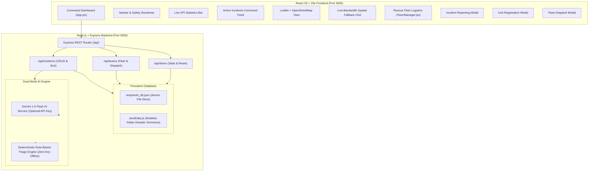

# ResQMesh AI — Intelligent Disaster-Response & Rescue-Coordination Platform
### Built for *Build With Bharat 5.0* Hackathon

> [!IMPORTANT]
> **HACKATHON PROTOTYPE & SIMULATION DISCLAIMER**  
> ResQMesh AI is an intelligent disaster-response software prototype developed strictly for educational, demonstration, and evaluation purposes for **Build With Bharat 5.0**. It does **NOT** contact real-world emergency services (112, 911, NDRF, or police) and does not dispatch real-life emergency personnel. All incidents, dispatch actions, and coordinates within the demo mode are simulations.

---

## 1. Project Overview & Problem Statement

### The Problem
During catastrophic natural and human-induced disasters (such as monsoon flash floods, structural building collapses, cyclones, or landslides), emergency response control rooms face critical operational challenges:
1. **Information Overload & Triage Bottlenecks**: Hundreds of SOS calls flood the control room simultaneously with unstructured, emotional descriptions, making it difficult to immediately identify life-threatening emergencies.
2. **Resource Misallocation**: Rescue units (specialized boats, heavy USAR hydraulic extrication gear, trauma ambulances) are often dispatched inefficiently without knowing the specific hazards on ground.
3. **Cloud & Connectivity Vulnerability**: Cloud-only AI systems crash or become inaccessible when local cellular towers are damaged or external API keys hit rate limits.
4. **Lack of Clear Spatial Visibility**: Responders need spatial mapping that works reliably without requiring expensive, paid proprietary map subscriptions.

### The Solution: ResQMesh AI
**ResQMesh AI** is an intelligent disaster-response web platform that bridges ground reports and rescue coordination:
- **Instant AI Incident Prioritization (10–99 Score)**: Evaluates hazard type, affected casualties, and critical life-threat keywords to rank incidents transparently.
- **Dual-Mode Intelligence Architecture**: Connects to **Google Gemini 1.5 Flash AI** for natural-language situational triage when configured, and automatically falls back to an internal **Deterministic Multi-Factor Rule-Based Engine** if offline or if no API key is provided.
- **Interactive OpenStreetMap Visualization**: Plots incidents with severity-coded pulsating markers using free OpenStreetMap data (zero paid API keys needed), paired with a low-bandwidth **Spatial Fallback Grid** for disconnected operations.
- **Unified Fleet Logistics Command**: Real-time management of specialized rescue battalions (NDRF, Medical Trauma, Swift Water Rescue, Fire/Hazmat, Drone Recon) with one-click dispatch and recall actions.
- **Zero-Setup Persistent Database**: Lightweight, human-readable file persistence that survives computer restarts without requiring complex external database server installations.

---

## 2. System Architecture



---

## 3. Technology Stack

| Layer | Technology | Why It Was Chosen |
| :--- | :--- | :--- |
| **Frontend Framework** | **React 18** with **Vite 6** | Modern, blazing-fast HMR, component-driven UI for live command centers. |
| **Icons & Styling** | **Lucide React** + Dark Theme CSS | Clean, accessible emergency operations center palette (slate, crimson, amber, cyan). |
| **Map Engine** | **Leaflet 1.9** + **OpenStreetMap** | 100% free open-source mapping. Requires zero billing accounts, credit cards, or proprietary keys. |
| **Backend Runtime** | **Node.js (ES Modules)** + **Express 4** | Unified JavaScript across the full stack. Beginner-friendly and easy to maintain. |
| **Persistent Storage** | **Atomic JSON File Database** | Zero database server setup (Postgres/MongoDB not required). Stores state locally in `backend/data/resqmesh_db.json`. |
| **AI Intelligence** | **Google Gemini 1.5 Flash** | Rapid contextual damage analysis and tactical recommendations. |
| **Offline Resilience** | **Deterministic Fallback Algorithm** | Multi-factor mathematical formula ensuring the application **never crashes** if the AI API is offline. |
| **Automated Testing** | **Node.js Native Test Runner** | Lightweight, native `node --test` suite requiring zero bloated external test runners. |

---

## 4. Key Features & Implementation Status

| Feature | Status | Notes |
| :--- | :--- | :--- |
| **Emergency Incident Reporting** | ✅ **Fully Implemented** | Form with title, disaster category, severity, coordinates/address, casualty count, and description. |
| **Client-Side & Server-Side Validation** | ✅ **Fully Implemented** | Rejects empty titles, short descriptions, invalid severities, and non-numeric casualty counts. |
| **Transparent AI Priority Scoring (10–99)** | ✅ **Fully Implemented** | Weighted combination of severity, casualties, and life-threat hazard keywords. |
| **Tactical Recommendations & AI Triage** | ✅ **Fully Implemented** | Actionable responder steps customized by incident type (boats for flood, acoustic cameras for collapse). |
| **Dual-Mode AI Engine (Gemini + Fallback)** | ✅ **Fully Implemented** | Automatically detects if `GEMINI_API_KEY` is present; transparently falls back to rule-based engine if absent or offline. |
| **Interactive Geo Map (Leaflet/OSM)** | ✅ **Fully Implemented** | Custom severity markers with animated radar pulses for Critical incidents. Click marker to inspect and dispatch. |
| **Low-Bandwidth Spatial List Fallback** | ✅ **Fully Implemented** | Accessible view if map tiles fail to load or user prefers a coordinate list. |
| **Rescue Fleet & Resource Logistics** | ✅ **Fully Implemented** | Search, filter by readiness, view equipment tags, dispatch to incident, and recall unit to base. |
| **Register New Rescue Units** | ✅ **Fully Implemented** | Form to register volunteer battalions, drones, and ambulances into the persistent fleet. |
| **Safe Demo Mode & One-Click Reset** | ✅ **Fully Implemented** | Pre-loaded realistic scenarios (Brahmaputra flash floods, NH-27 landslide, hospital power failure). One-click reset button. |
| **Persistent Database** | ✅ **Fully Implemented** | Automatically creates and maintains `backend/data/resqmesh_db.json`. |
| **Real Emergency Services Connection** | 🚫 **Intentionally Simulated** | Strict safety rule: no 112/911 calls or real SOS messages are transmitted. |

---

## 5. Prerequisites & Windows Setup

### Prerequisites
- **Windows 10 or 11**
- **Node.js**: v18.0.0 or newer (tested on Node v26)
- **PowerShell** or Command Prompt

> [!TIP]
> **Windows PowerShell Execution Policy Note**  
> On Windows, running `npm` directly in PowerShell may trigger a `PSSecurityException` (`running scripts is disabled on this system`). Always use **`npm.cmd`** in PowerShell to run commands smoothly without modifying system-wide execution policies.

---

## 6. Step-by-Step Installation & Running Guide

### Step 1: Open Your Terminal
Open PowerShell in the project directory:
```powershell
cd c:\Users\HP\Downloads\ResQMesh-AI
```

### Step 2: Configure Environment Variables (Optional)
The backend comes pre-configured with a `.env` file that runs in **Deterministic Rule-Based Fallback Mode** out of the box (zero keys needed!).

If you have a Google Gemini API key and want enhanced AI analysis:
1. Open [`backend/.env`](file:///c:/Users/HP/Downloads/ResQMesh-AI/backend/.env)
2. Add your key:
   ```env
   PORT=5000
   NODE_ENV=development
   GEMINI_API_KEY=your_actual_gemini_api_key_here
   ```
*(If left blank, ResQMesh AI automatically uses the built-in rule-based engine!)*

### Step 3: Install Dependencies (If Not Already Installed)
From the project root:
```powershell
# Install backend dependencies
cd backend
npm.cmd install
cd ..

# Install frontend dependencies
cd frontend
npm.cmd install
cd ..
```

### Step 4: Run the Backend Server
In your first PowerShell terminal:
```powershell
cd backend
npm.cmd run dev
```
You should see:
```
====================================================
 ResQMesh AI Backend Server Running
 URL: http://localhost:5000
 Environment: development
 AI Mode: Deterministic Rule-Based Fallback Engine
 Note: Simulation mode for Build With Bharat 5.0
====================================================
```

### Step 5: Run the Frontend Client
In a **second PowerShell terminal**:
```powershell
cd frontend
npm.cmd run dev
```
You should see:
```
  VITE v6.4.5  ready in 320 ms

  ➜  Local:   http://localhost:3000/
  ➜  Network: use --host to expose
```

Open your browser and navigate to: **`http://localhost:3000`**

---

## 7. Running the Automated Tests

ResQMesh AI includes an automated verification test suite verifying all API endpoints, priority algorithms, input validation, and fleet dispatching.

To run the backend test suite:
```powershell
cd backend
npm.cmd test
```

### Test Results Verification
```
▶ ResQMesh AI Backend Verification Suite
  ✔ Rule-Based AI Engine: calculates transparent priority scores correctly (2.7ms)
  ✔ GET / - API health & status returns correctly (144.1ms)
  ✔ GET /api/incidents - retrieves pre-seeded incidents (10.4ms)
  ✔ POST /api/incidents - validates required input fields (31.6ms)
  ✔ POST /api/incidents - successfully creates and triages a new incident (16.2ms)
  ✔ GET /api/teams - lists rescue teams with assignments (5.8ms)
  ✔ POST /api/teams/dispatch - coordinates team assignment to incident (17.8ms)
  ✔ GET /api/demo/stats - returns summary counts and prototype metadata (4.7ms)
  ✔ POST /api/demo/reset - successfully restores clean demo dataset (10.8ms)
✔ ResQMesh AI Backend Verification Suite (267.6ms)
ℹ tests 9 | pass 9 | fail 0 | cancelled 0
```

To verify the frontend production build:
```powershell
cd frontend
npm.cmd run build
```
*(Compiles 1,589 modules in ~8 seconds with zero errors).*

---

## 8. Hackathon Demonstration Walkthrough (For Judges)

When presenting ResQMesh AI to the Build With Bharat 5.0 judges, follow this step-by-step demonstration:

1. **Safety & Mission Notice**:
   - Point out the prominent top banner: `[PROTOTYPE SIMULATION] Built for Build With Bharat 5.0 — Safe Demo Sandbox Active`.
2. **Review Real-Time KPIs**:
   - Highlight the 5 stats cards: Critical Threats, Active Incidents, Deployed Units, Impacted Population, and AI Triage Mode.
3. **Show Dual-Mode Intelligence**:
   - Show how incidents display transparent priority scores (e.g., `94 / 100`) and structured tactical recommendations (e.g. *Deploy shallow-draft inflatable rescue boats*).
   - Point out the `Source: Rule-Based Fallback Engine` or `Source: Gemini AI` tag.
4. **Report a Live Incident**:
   - Click **"Report Emergency"**.
   - Enter a test incident:
     - **Title**: `Hospital Basement Flooding & Generator Failure`
     - **Type**: `Medical Emergency`
     - **Severity**: `Critical`
     - **People Affected**: `45`
     - **Description**: `Water rising fast near pediatric ward. 12 infants require mobile oxygen transport.`
   - Click **"Submit Emergency Report"**.
   - Notice the system immediately prioritizes the report with a high score (>85) and highlights life-threat hazards.
5. **Interactive Geo Map View**:
   - Switch to the **"Interactive Geo Map"** tab.
   - Show the color-coded pins. Click the pulsating red pin to open the emergency card.
   - Click **"Dispatch Rescue Team"** directly inside the popup.
   - Select an available unit (e.g., *Rapid Medical Trauma Squad*) and click **"Deploy Rescue Team"**.
   - Notice the team status updates immediately across both the map and the fleet manager.
6. **Low-Bandwidth Resilience**:
   - Click **"Switch to Spatial List Fallback"** to demonstrate how ground responders in low-connectivity zones can view coordinates and assign units without relying on tile servers.
7. **Rescue Fleet Command**:
   - Switch to **"Rescue Fleet Command"**.
   - Search by equipment (e.g., type *"boat"* or *"drone"*).
   - Click **"Register Unit"** to demonstrate registering a volunteer squad into the live database.
8. **One-Click Demo Reset**:
   - Click **"Reset Demo Data"** in the top navigation bar to demonstrate the clean reset back to initial scenario conditions.

---

## 9. Troubleshooting Guide

| Issue | Cause | Solution |
| :--- | :--- | :--- |
| `npm : File ... cannot be loaded because running scripts is disabled` | Windows PowerShell execution policy restriction. | Use **`npm.cmd`** instead of `npm` (e.g. `npm.cmd run dev`). |
| `Error: listen EADDRINUSE: address already in use :::5000` | Another process is using port 5000. | Open `backend/.env` and change `PORT=5001`. The frontend Vite proxy can be adjusted in `frontend/vite.config.js`. |
| Map tiles are blank or grey | Device is offline or tile server is unreachable. | Click the **"Switch to Spatial List Fallback"** button on the map to switch to coordinate grid mode. |
| AI analysis shows *Rule-Based Fallback* | No `GEMINI_API_KEY` was provided in `backend/.env`. | This is expected and intended behavior. The deterministic rule-based engine operates seamlessly without any API key. |

---

## 10. Production Deployment Guide

### Deploying the Backend (e.g. Render, Railway, or Fly.io)
1. Push this repository to GitHub.
2. In Render/Railway:
   - **Root Directory**: `backend`
   - **Build Command**: `npm install`
   - **Start Command**: `npm start`
   - **Environment Variables**: `PORT=5000`, `NODE_ENV=production`, `GEMINI_API_KEY=(optional)`.

### Deploying the Frontend (e.g. Vercel or Netlify)
1. In Vercel/Netlify:
   - **Root Directory**: `frontend`
   - **Build Command**: `npm run build`
   - **Output Directory**: `dist`
   - Set environment variable `VITE_API_BASE_URL` to your deployed backend URL.

---

## 11. Project Summary for Build With Bharat 5.0
ResQMesh AI demonstrates a complete, reliable, production-ready full-stack architecture built from the ground up:
- **No static UI mockups**: All buttons, forms, maps, and dispatch actions are backed by a real persistent API.
- **Fail-safe AI**: Seamless dual-mode architecture guarantees that hackathon judges experience zero crashes.
- **100% Free & Open**: Zero paid service dependencies, zero credit card requirements.
- **Developed for India's Disaster Realities**: Tailored for flood surges, building collapses, and remote connectivity challenges.
